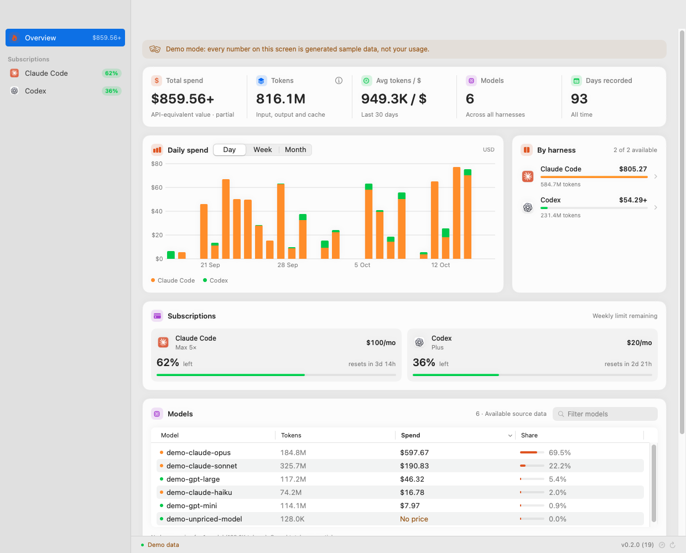
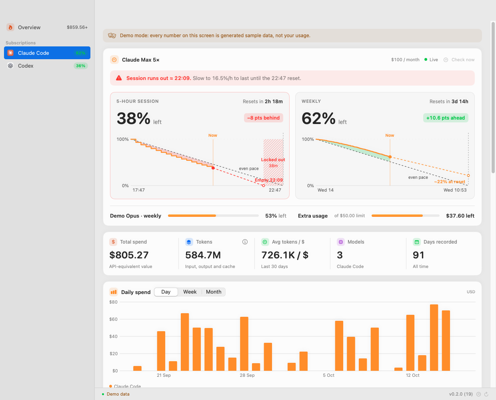
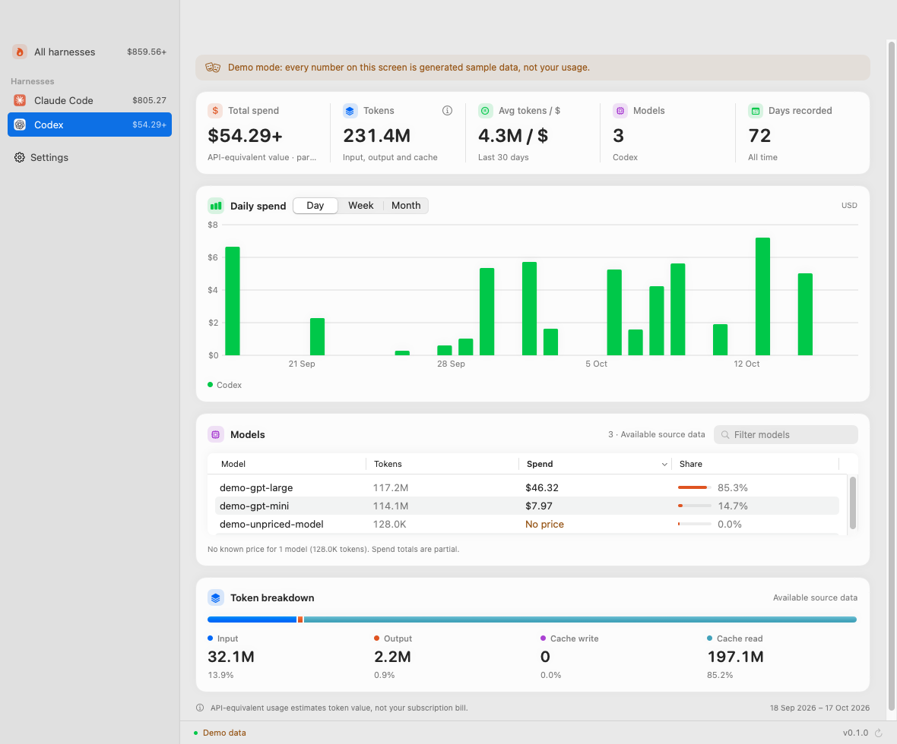
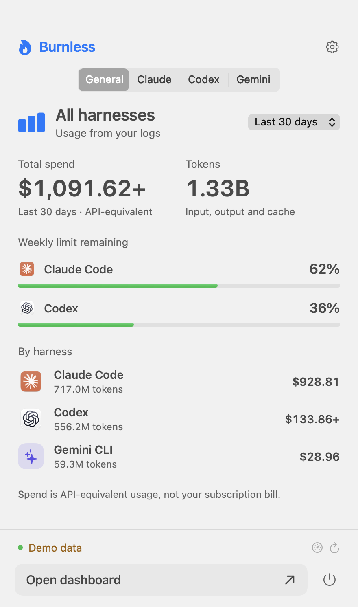
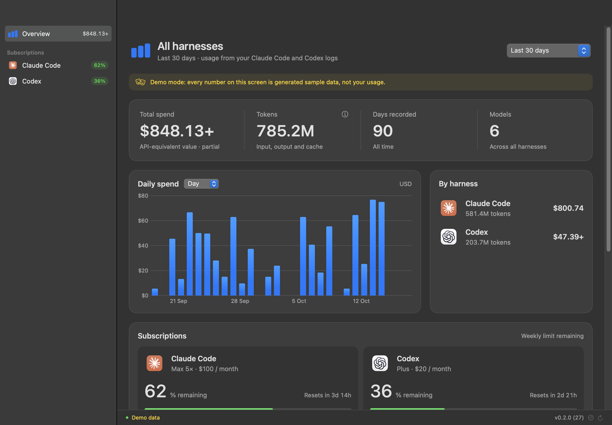
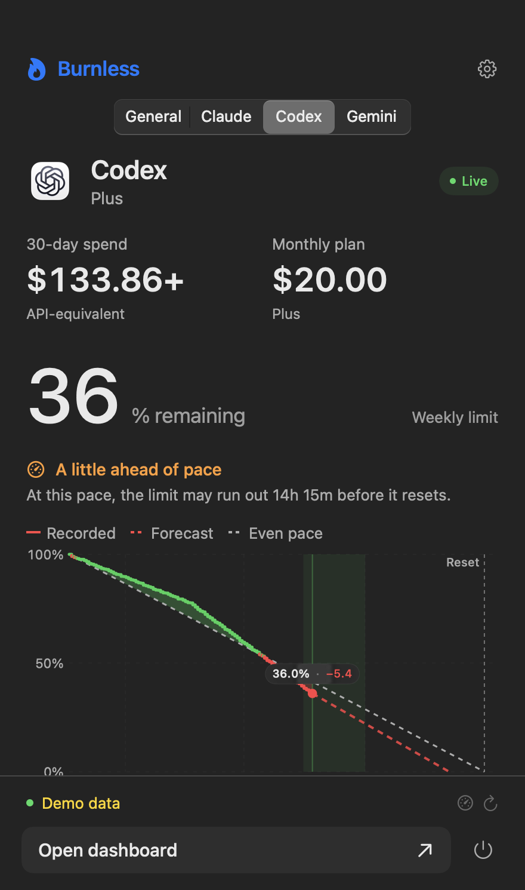
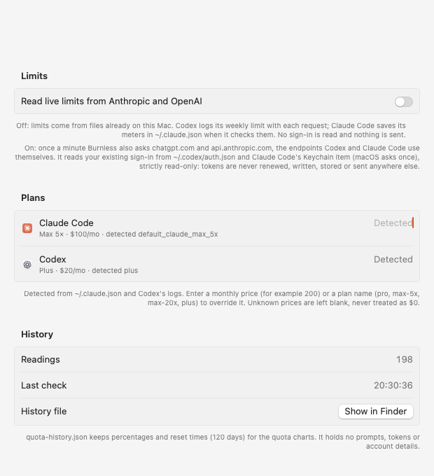

# Burnless

A native macOS app for **Claude Code**, **Codex** and **Gemini CLI**: API-equivalent spend, tokens,
models, subscription limits with pace and forecast, plan value, and a menu bar
quota. Everything is read from files on your Mac by default.

Burnless is [Agent Burn](https://github.com/Melvynx/agent-burn) focused on two
harnesses: the same dashboard, quota charts, menu bar and settings, for Claude Code
and Codex only. Its data engine is [ccusage](https://github.com/ccusage/ccusage).



| Claude Code | Codex | Menu bar |
| --- | --- | --- |
|  |  |  |

| Dark | Menu bar · Codex | Settings · Quotas |
| --- | --- | --- |
|  |  |  |

The layout follows the screenshots on Agent Burn's site: a page header, large
numbers without icon badges, the system accent color and a flat menu bar
popover. Screenshots use the built-in demo mode; none of these numbers are
real usage.

## What it shows

**Subscription limits** (top of each harness page):

- **Claude**: 5-hour session and weekly limits side by side, each with remaining share,
  pace badge (`+10 pts ahead` / `−8 pts behind`), reset countdown and an until-reset chart
  with even pace, forecast and the locked-out span when you would run out early. A
  one-line verdict ("On track." / "Session runs out ≈ 22:04."), model-scoped weekly
  limits and extra usage credits.
- **Codex**: weekly quota with remaining, pace, reset time, used share, suggested daily
  pace, $ per percent, banked resets and the shorter window when Codex reports one. The
  chart range is selectable (Until reset, Reset to today, Today, Last 7 / 30 days). With
  live limits, the weekly limit used per day by surface or by model.
- **Gemini CLI**: usage only (spend, tokens, models, daily chart). Gemini CLI keeps no
  limit reading on disk, so there is no quota chart; run `/stats` in Gemini CLI for that.
- **Plans**: detected from `~/.claude.json` (Claude rate-limit tier) and Codex's logs
  (plan type), with monthly prices for known plans (Pro, Max 5×, Max 20×, Plus, Pro 5× at $100, Pro).
  Unknown prices stay unknown; set one in Settings → Quotas. Gemini CLI logs no plan:
  enter `plus`, `pro` or `ultra` (Google AI Plus $4.99, Pro $19.99, Ultra $249.99) or a price.
- **Subscription economics**: last 30 days at API prices vs. the plan price (value
  multiple, subsidy, discount), daily usage in the current window, spend by token type,
  8-week trend, quota value estimate and Codex image generations.

**Usage**:

- **Total spend**: API-equivalent value of the tokens in the selected period.
- **Tokens**: input, output, cache write and cache read (breakdown in the ⓘ popover
  and the Token breakdown card).
- **Avg tokens / $** and **Models**, as in Agent Burn.
- **Days recorded**: distinct days with usage in all available history (not
  affected by the period).
- **Daily spend**: Swift Charts histogram, stacked by harness in the overview,
  with Day / Week / Month and hover details.
- **By harness**: Claude Code and Codex spend, tokens and comparison bar. Click
  one to open its view.
- **Models · Available source data**: models seen in your logs, with tokens,
  spend and share. You can search and sort them.

Periods: Today, Yesterday, Reset to date, Week to date, This month, Last 7 days,
Last 30 days (default), Year to date, All time. Navigation: Overview (with a
Subscriptions card), Claude Code, Codex. Refresh with ⌘R; check limits now with ⇧⌘R.

**Menu bar**: a flame with the weekly remaining of the harness you choose, and a popover
with General / Codex / Claude tabs (spend, tokens, quota remaining, busiest agents, top
models, weekly chart and usage details). Optional menu-bar-only mode, launch at login,
background collection and update checks are in Settings.

## Install

Requirements to **build** (not needed to run the built app):

- macOS 14 or newer, Xcode Command Line Tools with Swift 6 (`xcode-select --install`)
- [rustup](https://rustup.rs); the engine pins Rust 1.97.1 in
  `engine/rust-toolchain.toml` and rustup installs it on first build

```sh
git clone https://github.com/Hug0x0/burnless && cd burnless
./scripts/build-app.sh          # → dist/Burnless.app (ad-hoc signed)
open dist/Burnless.app          # or move it to /Applications
```

The app bundles its engine (`Contents/Resources/burnless-engine`). It does not need
Node, npx, Rust or ccusage installed to run.

## Development

| Task | Command |
| --- | --- |
| Run in development | `./scripts/dev.sh` (add `--demo` for sample data) |
| Run all tests | `./scripts/test.sh` |
| Build the app | `./scripts/build-app.sh` |
| Screenshots | `./scripts/capture.sh <dir> [--demo]` |
| Regenerate icon | `swift scripts/make-icon.swift app/Sources/Burnless/Resources/AppIcon.icns` |

Layout:

```
engine/   Rust CLI on top of ccusage's Claude, Codex and Gemini adapters → versioned JSON
app/      SwiftPM package
  Sources/BurnlessCore   report decoding, merge/cache, aggregation (UI-free, tested)
  Sources/Burnless       SwiftUI + Swift Charts app
scripts/  build, test, dev, capture, icon
```

Dependencies are locked: `engine/Cargo.lock` (ccusage pinned to revision
`57e5658`) and the vendored pricing snapshot. The Swift package has no external
dependencies.

## Sources

Burnless only reads local history. It uses ccusage's resolution:

| Harness | Default | Override |
| --- | --- | --- |
| Claude Code | `~/.config/claude/projects`, `~/.claude/projects` | `CLAUDE_CONFIG_DIR` (comma-separated) |
| Codex | `~/.codex/sessions`, `~/.codex/archived_sessions` | `CODEX_HOME` (comma-separated) |
| Gemini CLI | `~/.gemini/tmp/<project>/chats` | `GEMINI_DATA_DIR` (comma-separated) |

Settings → Sources shows the folders being read and lets you **Choose Folder…**
for each harness (passed to the engine as the variables above). If one source is
missing or fails, the other still works.

Privacy and safety:

- History is opened read-only. Logs, credentials, sessions and tool settings are never modified.
- The engine outputs only dates, model names, token counts and costs. Prompts and
  conversations are never stored or displayed.
- There's no account, no API key and no telemetry. Nothing is sent anywhere unless you
  enable *Fetch current prices* (downloads LiteLLM's public price list), *Read live
  limits* (see below) or *Check for updates* (reads the public GitHub release list).
- Cloud conversations that are not in the local history are not counted.

## Limits and live readings

By default Burnless reads limits from files already on your Mac, with no sign-in and no
network request:

- Codex writes the account `rate_limits` it enforced with each request to its session
  logs; Burnless reads the newest one (side limits such as Spark are skipped).
- Claude Code saves the meters it last fetched in `~/.claude.json`
  (`cachedUsageUtilization`), next to the account's rate-limit tier. Burnless ignores
  meters that belong to a different signed-in account.

These are as fresh as the last time Claude Code or Codex wrote them; each card says how
old its reading is. Settings → Quotas → **Read live limits** (off by default) also asks
the providers once a minute, using the endpoints Codex and Claude Code call themselves:
`chatgpt.com/backend-api/wham/usage` with the token in `~/.codex/auth.json`, and
`api.anthropic.com/api/oauth/usage` with Claude Code's Keychain item
(`Claude Code-credentials`; macOS asks for permission once). Sign-ins are used strictly
read-only: Burnless never renews, writes or stores a token. An expired Claude sign-in is
reported and Claude Code renews it on its next run. Rate limits (HTTP 429) are honoured,
and the app and background collector share one pacing so Anthropic is asked at most
once a minute.

Readings (percentages and reset times only) are kept for 120 days in
`~/Library/Application Support/Burnless/quota-history.json` for the charts. As in Agent
Burn, a weekly reading far above the last half hour's lowest one is treated as a provider
over-count until confirmed, and replays of an earlier window are ignored. Forecasts
extend the observed pace to reset; even pace spreads the limit evenly over the window.

**Background collection** (Settings → Background, off by default) registers a launch
agent (`Contents/Library/LaunchAgents/io.github.hug0x0.burnless.quota.plist`) that runs
`Burnless --collect-quotas` every minute, so charts have no gaps when the app is closed.

## How numbers are calculated

The engine (`engine/`) calls ccusage's own loaders. It does not reimplement the parsers:

- **Claude Code**: `load_daily_summaries_with_detection`, with ccusage's message/request
  deduplication across files and resumed sessions.
- **Gemini CLI**: `load_entries` + `summarize_entries` (daily). Cached input is split from
  input; thinking tokens are billed as output and also shown as reasoning.
- **Codex**: `load_groups` (daily). This turns the cumulative `total_token_usage`
  counters into deltas and skips repeated counters. Copies of a session in
  `archived_sessions` are not counted twice.
- Days are grouped in your Mac's time zone (passed explicitly as `--timezone`), so
  DST days work correctly.

Each row is a (source, local date, model) cell. Token fields mean the same thing for both sources:

- `input`: input that was neither read from nor written to cache. Codex reports
  input *including* cache, so ccusage's `non_cached_input_tokens` normalizes it.
- `cache read` / `cache write`: cached input read / written.
- `output`: generated tokens. Codex reasoning tokens are included and also shown
  separately in the popover.
- `total` = input + output + cache write + cache read. No token is counted twice.

**Cost** follows ccusage's default mode. It uses the cost logged by Claude Code when
present, and otherwise per-token API prices. Prices come from a vendored
[LiteLLM snapshot](engine/pricing/README.md) (revision `1fd7f81`, 2026-10-17) embedded
at build time, plus ccusage's models.dev data. That makes the app work offline.

**Unknown prices are never shown as $0.** Rows whose model has no price are flagged.
Totals then show only the known value, with a `+` and "partial". The Models table
shows "No price" for those models. Usage logged without a model name is listed as
**Unattributed**. Models marked **?** include Codex usage without an exact model name
(for example auto-review), which ccusage assigns to the closest priced model.

Chart, cards and table always add up to the same totals for the same scope. *Share* is a
model's part of the total cost in the selected period and harness, before text search.

> API-equivalent usage estimates token value, not your subscription bill.

Verified on the author's Mac on 2026-10-17: Burnless totals match
`ccusage claude|codex daily --json --offline` from the same pinned revision. Codex
matched exactly. Claude matched apart from the usage written live by an active session
between the two runs.

## Refresh and storage

- Usage loads automatically at launch. Refresh with ⌘R, the toolbar or the footer.
  Automatic refresh runs every 5 minutes by default (configurable, off when the app is closed).
- Reading runs off the main thread in the bundled engine. Each refresh replaces a
  source's rows wholesale, so repeated refreshes cannot duplicate usage.
- Cache: `~/Library/Application Support/Burnless/usage-cache.json` (atomic writes,
  previous valid copy kept as `.bak`). If a source fails, its last good data stays
  visible and is marked as saved data. Days after its last successful read appear as
  *Not read* in the chart, which is different from days with no activity.
- Filters are computed synchronously from the current snapshot, so the screen always
  matches the current selection.

## Limits

- Only Claude Code, Codex and Gemini CLI (no Cursor or other harnesses, by design). Gemini
  usage in the Gemini app or Antigravity is not in Gemini CLI's logs and is not counted.
- Without live limits, Claude's meters are only as recent as Claude Code's own last check.
  Codex's daily breakdown by surface and model needs live limits.
- Plan prices are a built-in table; team plans have no price until you set one. Image generations use a $0.15 per image estimate, outside spend totals.
- Estimates depend on the pricing snapshot. New models may show as unpriced until the
  snapshot is updated or *Fetch current prices* is enabled.
- History deleted from disk can't be reconstructed. The cache only keeps data for a
  source while that source is failing.
- The build is ad-hoc signed for local use. It is not notarized for distribution, and
  Check for Updates only links to new GitHub releases (no automatic install).

## Troubleshooting

- **"History folder not found"**: check Settings → Sources. Use *Choose Folder…* if your
  Claude config or Codex home is in a custom location.
- **"Could not be read"**: the error is shown under the source in Settings. The other
  source and the cached data still work.
- **"The Burnless engine was not found"**: rebuild with `./scripts/build-app.sh`. For
  `swift run`, build the engine first (`./scripts/dev.sh` does both), or set
  `BURNLESS_ENGINE=/path/to/burnless-engine`.
- **Numbers look off**: compare with `engine/target/release/burnless-engine report --timezone "$(readlink /etc/localtime | sed 's#.*/zoneinfo/##')"`.
- **Gatekeeper warning** on another Mac: the app is ad-hoc signed. Right-click → Open, or
  sign with `BURNLESS_SIGN_IDENTITY="Developer ID Application: …" ./scripts/build-app.sh`.

## Demo mode

`open dist/Burnless.app --args --demo` shows generated sample data with a visible
banner. Demo data is never written to the cache. Screenshot options use environment
variables (`BURNLESS_CAPTURE`, `BURNLESS_ROUTE`, `BURNLESS_PERIOD`,
`BURNLESS_APPEARANCE`, `BURNLESS_WINDOW_SIZE`); see `scripts/capture.sh`.

## License and credits

MIT, see [LICENSE](LICENSE). Built on ccusage (MIT, © ryoppippi) and adapted from
Agent Burn (MIT, © ryoppippi, © Melvynx): dashboard, quota chart, Claude account panels,
Codex limit chart, menu bar popover and settings. Pricing data comes from LiteLLM (MIT).
Provider logos belong to their owners. See [THIRD_PARTY_NOTICES.md](THIRD_PARTY_NOTICES.md).
